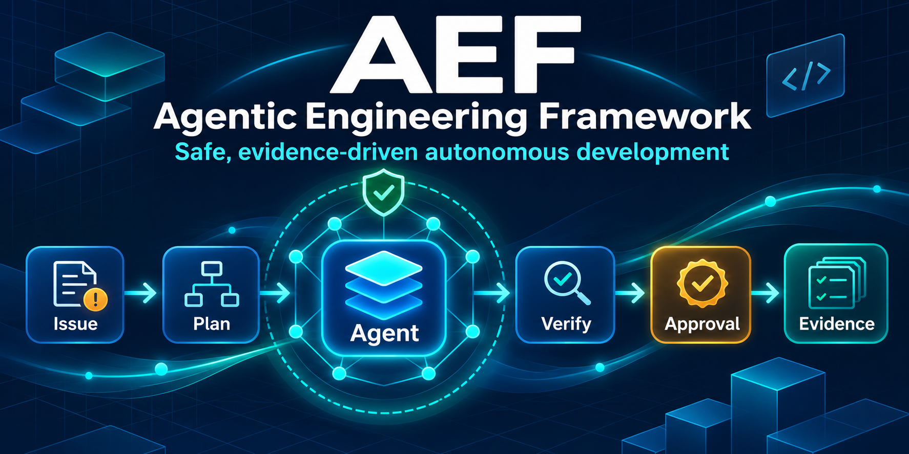
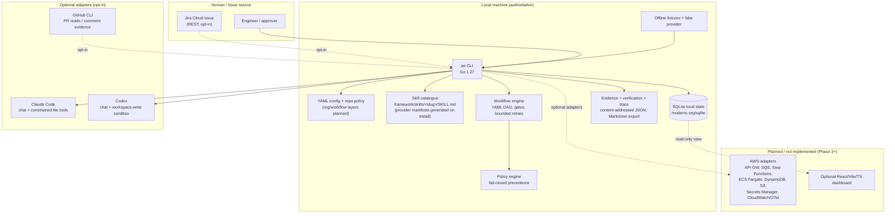

# Agentic Engineering (AE)



AE is a **portable, versioned catalogue of agent skills** plus an **optional local Go CLI** for taking engineering work from Jira issue to production with evidence at every step.

It is local-first and provider-neutral:

- No mandatory dashboard, Kubernetes cluster, paid service, or particular model.
- Task routing is provider-neutral: skills and agents name a profile such as `balanced` or `independent-review`; local `ae.yaml` resolves it to a provider model. See [model routing](docs/model-routing.md).
- Canonical skills are Markdown files at `framework/skills/<slug>/SKILL.md`; provider copies are generated locally with a manifest and SHA-256 checksums when installed.
- The CLI keeps authoritative state in a local SQLite database and works with offline fixtures and a fake provider, so the local lifecycle can be demonstrated without credentials.
- Cloud services (AWS API Gateway webhook, SQS, Step Functions Standard, ECS Fargate, DynamoDB, S3, Secrets Manager, CloudWatch/OTel, Terraform) are **optional adapters — planned / not implemented**.

> **Status:** Early development. The local/offline path covers planning, approvals, fake-provider runs, provider-neutral model routing, real local verification evidence, safe detached worktree preparation, structured review evidence and finding resolution, traceability reporting, structural fixture checks, fake-provider chat continuity, evidence export, and an opt-in `autopilot` loop that stops at real gates. Opt-in Jira Cloud intake, GitHub CLI reads/PR comments, provider chat, and constrained provider write modes are implemented locally but were **not exercised against live services** in this session. GitHub App/service identity, PR creation/merge/push, independently verified review, federated identity, cloud adapters, dashboard, and remaining Phase 3–7 work are **planned / not implemented**. Licensing under Apache-2.0 is **proposed**; see `NOTICE`.

## Architecture



Core packages contain no provider SDKs. Adapters translate between the local core and external systems; the fake provider implements the same interface for offline runs.

## Repository layout

- `framework/` — canonical skills, workflows, policies, agents, profiles,
  schemas, and templates. See [`framework/README.md`](framework/README.md).
- `internal/framework` — the single source of truth for those canonical paths.
- `internal/` — provider-neutral Go core; provider SDKs and CLIs live only in
  `internal/adapters/`.
- `cmd/ae/` — CLI entry point.
- `docs/`, `evaluations/`, `examples/`, `scripts/` — documentation, fixtures,
  demonstrations, and local verification scripts.

## Quickstart

Build from source (module publication via `go install ...@latest` is planned):

```sh
# 1. Build the CLI (macOS/Linux; see docs/installation.md)
go build -o ae ./cmd/ae

# 2. Scaffold local config for selected profiles
./ae init --profile go,react
# Other canonical profiles: java, python, laravel, typescript, and all

# 3. Check the local environment and validate the catalogue
./ae doctor
./ae validate

# 4. See the available skills and install them for your provider
./ae skills list
./ae skills install --provider claude --scope user --version 0.1.0 --dry-run
./ae skills install --provider codex --scope project --version 0.1.0
```

Use `--root DIR` to operate on a copy of the framework without writing to the current checkout. Provider paths are documented in [`docs/provider-compatibility.md`](docs/provider-compatibility.md); verify them before use because provider conventions change.

## Offline demo

No Jira credentials, cloud account, or network service are required:

```sh
ISSUE=examples/offline-workflow/issue-PROJ-101.json

# Deterministic preview; writes no state.
./ae plan --issue "$ISSUE"
./ae run feature-development --issue "$ISSUE" --provider fake --dry-run

# Real local run through the fake provider, stopping at the approval gate.
./ae run feature-development --issue "$ISSUE" --provider fake --actor demo-user

# Approve, resume, inspect, and export evidence.
./ae approve <run-id> --gate architecture --approver reviewer-1
./ae resume <run-id>
./ae status <run-id>

# Run real local checks and append their results as evidence.
./ae verify <run-id> --profile go

# Reconstruct requirement -> release traceability from evidence.
./ae trace <run-id> --format markdown --out trace.md

# Verify fixture structure without invoking a model.
./ae eval --suite all --execute

# Scan a diff locally, or run an opt-in strongest-model provider review.
./ae review --diff candidate.diff --run <run-id>
./ae review --diff candidate.diff --provider claude --skill security-review \
  --candidate-sha <sha> --base-sha <sha> --run <run-id> --dry-run
./ae review --diff candidate.diff --provider claude --skill security-review \
  --candidate-sha <sha> --base-sha <sha> --run <run-id> \
  --workspace .ae/worktrees/<run-id> --confirm-live
./ae review resolve --run <run-id> --finding rev-... \
  --status fixed --reason "fixed after local verification" --actor reviewer-1
./ae evidence export <run-id> --format both

# Multi-turn fake-provider conversation with a preserved session.
./ae chat --provider fake --message "first question" --run <run-id>
./ae chat --provider fake --session <session-id> --message "follow up" --run <run-id>

# Preview the orchestration loop; writes no state and calls no service.
./ae autopilot --issue "$ISSUE" --dry-run
```

The shorthand `PROJ-101` resolves to the fixture above. The fake provider returns outputs marked `simulated: true`; it does not run shell commands, call models, or create branches, commits, pushes, or deployments. A run that relies only on fake-provider output is **blocked with missing evidence** at the merge gate. `ae verify <run-id>` executes checked-in profile commands locally, records the command, sanitized output, and real exit status as evidence, and can satisfy those gates. Structured review findings must be explicitly resolved before merge. The full `feature-development` lifecycle includes independent code, security, architecture, and test reviews; provider-backed reviews use the strongest `independent-review` route from local config and never let untrusted text change it. See [integrations](docs/integrations.md) for opt-in Jira and live chat setup and [evidence](docs/evidence.md) for the record format.

Live Jira calls, GitHub CLI reads/comments, and live Claude/Codex conversations require explicit opt-in configuration/flags and environment credentials. The adapters and local tests exist, but no live service call was made in this session. `autopilot` executes only within recorded policy: it stops at approval gates, runs real local checks, never creates a branch/PR, never pushes/merges/deploys, and high-risk work remains blocked at independent review. GitHub App/service identity, PR creation/merge, cloud deployment, and federated identity are **planned / not implemented**.

## Example Jira workflow (design target)

1. `jira-intake` reads issue `PROJ-101` from a local fixture or, when explicitly configured and confirmed, Jira Cloud REST. An approved Jira MCP adapter remains planned. Issue text is untrusted data.
2. `requirement-analysis` and `acceptance-criteria` produce structured artifacts; `risk-assessment` classifies changed paths and semantics.
3. `technical-planning` and `solution-architecture` create a YAML DAG. Escalations (auth, billing, tenant isolation, IAM, secrets, infrastructure, migrations, data retention, public API) require approval.
4. `awaiting_approval` → `implementing` → `verifying` → `reviewing` → `remediating` (bounded loop) → `awaiting_merge` → `staging` → `awaiting_release` → `production_verification` → `completed`.
5. Every transition appends a transition record and content-addressed evidence; required evidence and approvals are checked before a gate opens.

Workflow states include `queued`, `analyzing`, `planning`, `awaiting_approval`, `implementing`, `verifying`, `reviewing`, `remediating`, `awaiting_merge`, `staging`, `awaiting_release`, `production_verification`, `completed`, `blocked`, `failed`, `cancelled`. Cycles are rejected except bounded remediation retries.

## Opt-in Jira link intake

Fixtures remain the default; no network call happens unless Jira Cloud is
explicitly configured in `ae.yaml`:

```yaml
integrations:
  jira:
    mode: jira-cloud
    baseURL: https://your-site.atlassian.net
    tokenEnv: AE_JIRA_TOKEN
```

Export the token in the named environment variable before running:

```sh
# `plan` and `--dry-run` use fixtures; live Jira intake requires an explicit live command.
./ae plan --issue examples/offline-workflow/issue-PROJ-101.json
./ae run feature-development --issue TEAM-123 --provider fake --confirm-live
```

Only HTTPS origins that match `baseURL`, bare issue keys, and supported Jira
browse links are accepted. Credentials never appear in flags, config, prompts,
fixtures, or URLs. Jira issues must carry `ae-acceptance:` and `ae-path:`
labels (or the equivalent description sections); missing AE metadata fails
closed instead of inventing acceptance criteria. See
[integrations](docs/integrations.md) for the full contract.

## Command status matrix

Status labels describe the current tree, not phase targets.

| Command | Status | Notes |
| --- | --- | --- |
| `ae init --profile go,react` | Implemented | Writes `ae.yaml` and creates `.ae` state, evidence, and objects directories. Canonical profiles include `java`, `python`, `laravel`, `typescript`, and the aggregate `all`; unknown names are rejected. See [profiles](docs/profiles.md). |
| `ae doctor` | Implemented | Local toolchain, schema, catalogue, state, and optional provider-binary checks; no cloud probes. |
| `ae validate` | Implemented | Schemas, skills, workflows, policies, agents, routing profiles, and config validation. |
| `ae skills list` | Implemented | Reads the canonical catalogue. |
| `ae skills install --dry-run` | Implemented | Prints planned writes; no filesystem changes. |
| `ae skills install --provider ... --scope ...` | Implemented | Generates provider copies with manifest + SHA-256; refuses unmanaged conflicts unless `--force`. |
| `ae skills uninstall` | Implemented | Removes only manifest-managed files unless `--force`. |
| `ae skills export --out ...` | Implemented | Generates plugin-ready bundle directories locally; not published. |
| `ae plan --issue <fixture\|Jira link\|key>` | Implemented locally | Fixtures only; a configured Jira Cloud link/key requires a live `run` or `autopilot` with `--confirm-live` and uses the opt-in REST adapter, not exercised live here. |
| `ae run <workflow> --issue <fixture> --dry-run` | Implemented, offline only | Deterministic preview; no state writes. |
| `ae run <workflow> --issue <fixture> --provider fake` | Implemented, local only | Real SQLite run with simulated task results; stops at gates and blocks on missing evidence. |
| `ae run ... --provider claude\|codex --confirm-live --workspace DIR [--allow-writes]` | Implemented locally, not exercised live | Live providers require explicit confirmation and a managed worktree; `--allow-writes` uses constrained file tools/sandbox, never shell tools. |
| `ae status <run-id>` / `status --list` | Implemented, local only | Reads persisted run state and transitions. |
| `ae resume <run-id> [--provider ...] [--confirm-live] [--allow-writes]` | Implemented, local only | Advances until a gate, policy denial, completion, or block; live continuation uses the same opt-in checks as `run`. |
| `ae cancel <run-id>` | Implemented, local only | Atomic cancellation with a recorded reason. |
| `ae approve <run-id> --gate ... --approver ... [--role ...]` | Implemented, local only | Records identity, role, candidate SHA, plan digest, and review-evidence digest; checks distinct roles and invalidates on configured review-findings changes. |
| `ae review --diff <path> [--run id]` | Implemented, local only | Deterministic pattern-scan hypotheses; `verified: false`. With `--run`, persists chained review evidence. Live `--pr` GitHub review is not implemented. |
| `ae review --diff <path> --provider claude\|codex\|fake [--skill ...] [--run id] [--dry-run] [--confirm-live --workspace DIR]` | Implemented locally, not exercised live | Opt-in canonical-skill review through a provider adapter; fixed `independent-review` route, requested/actual model evidence, strictly parsed hypotheses, and chained review evidence. The fake provider returns a simulated no-op that cannot satisfy the gate; only a non-simulated, model-selected provider review can. |
| `ae review resolve --run id --finding rev-... --status fixed\|accepted\|false-positive --reason text` | Implemented, local only | Records a human decision as chained remediation evidence; unresolved findings block merge/release/security-signoff gates. |
| `ae chat --provider fake --message text [--route PROFILE]` | Implemented, local only | Multi-turn fake conversation; preserves session IDs and writes chained evidence with `--run`. |
| `ae chat --provider claude\|codex --confirm-live --workspace DIR [--route PROFILE] ...` | Implemented locally, not exercised live | Explicit opt-in, env-based auth, managed AE worktree, bounded turns, route-to-model resolution, and sanitized evidence. |
| `ae autopilot --issue ...\|--resume ... [--dry-run] [--confirm-live] [--allow-writes] [--approver name --confirm-gates] [--github-pr ref] [--comment --confirm-mutate]` | Implemented locally, not exercised live | Opt-in orchestration loop: creates/binds a managed worktree, advances provider tasks, runs real local checks, scans the workspace diff, and stops at gates. No branch, PR creation, push, merge, or deployment. |
| `ae verify <run-id> [--profile ...]` | Implemented, local only | Executes checked-in profile commands plus a built-in secret-shape scan; records command, sanitized output, and real exit status as evidence. Missing tools are recorded as failures, not passes. |
| `ae worktree prepare|clean <run-id>` | Implemented, local only | Creates/removes a detached worktree under `.ae/worktrees`; no branch, commit, force-remove, push, or deploy. Requires a git repo with a commit. |
| `ae run ... --workspace <path>` | Implemented, local only | Accepts only AE-managed worktree directories and records the workspace in run evidence; a bound workspace is never silently re-pointed. |
| `ae trace <run-id> [--format ...] [--out ...]` | Implemented, local only | Reconstructs lifecycle coverage from persisted evidence; missing stages remain `missing`. |
| `ae evidence export <run-id>` | Implemented | JSON/Markdown exports from stored run evidence. |
| `ae eval --suite ...` | Implemented as inventory only | Reports authored fixtures as `executed: false`. |
| `ae eval --suite ... --execute` | Implemented, local only | Runs deterministic structural checks on fixtures; `modelBehaviorExecuted: false` because no model is invoked. |
| Live Jira/Claude/Codex execution | Implemented locally, not exercised live | Opt-in adapters with env credentials and local stub/HTTP tests; no live call or provider login was performed. |
| GitHub CLI adapter (`gh pr view/checks/diff/comment`) | Implemented locally, not exercised live | Reads PR state and records sanitized evidence; PR comments require `--comment --confirm-mutate`. No push, PR creation, merge, or GitHub App identity. |
| GitHub App/service identity, cloud adapters, dashboard | Planned / not implemented | Docs and interfaces exist; no live behavior was exercised. |

## Skills shipped

`jira-intake`, `requirement-analysis`, `acceptance-criteria`, `technical-planning`, `risk-assessment`, `solution-architecture`, `backend-development`, `git-worktree-management`, `unit-testing`, `code-review`, `security-review`, `architecture-review`, `test-review`, `agent-handoff`, `pull-request-management`.

The full catalogue across Product, Architecture, Cloud, Development, Quality, Security, DevOps, and Agentic domains is **planned**.

## Security model

- **Policy precedence (highest to lowest):** immutable runtime safety > org > repo > workflow defaults > agent instructions > untrusted task content. Fail closed on conflict, missing policy, unknown semantic tags, or validation error.
- **Trust boundaries:** Jira/GitHub/MCP content, repository files, model output, and provider plugins are untrusted. They can never override runtime safety, policy, or model routing. Routes resolve only from workflow tasks, canonical skill/agent metadata, and local config.
- **Credentials:** no tokens in flags, config, prompts, or fixtures; use environment variables or an external secret store. Approvals record local identity/role and digests; federated identity and PR authorization are planned.
- **Supply chain:** canonical skills are source Markdown; generated provider manifests carry SHA-256 checksums. CI actions should be pinned to verified SHAs before release (currently a TODO in `.github/workflows/ci.yml`).
- **Isolation:** `ae worktree prepare` and `ae autopilot` can create a detached, AE-managed worktree from `HEAD`; arbitrary paths, branches, commits, force-removal, and user-owned work are refused. Workspace flags require a registered git worktree, and `autopilot` binds a run-owned worktree before any provider task, including pre-approval tasks. Live provider writes require `--allow-writes` plus `--confirm-live` and are constrained to Claude file tools with outside-worktree permission blocks (Claude Code v2.1.314+) or Codex `workspace-write`; they remain unexercised against live providers.
- **Executable profiles:** `ae verify` runs shell commands from checked-in `framework/profiles/*/profile.yaml`. Treat profiles as executable configuration and use `verify` only in repositories you trust; commands never come from issue text or CLI flags.
- Details: [`docs/security/threat-model.md`](docs/security/threat-model.md) and [`SECURITY.md`](SECURITY.md).

## Limitations

- Pre-1.0, no stable compatibility guarantees.
- Fifteen Phase 1 skills exist, including four strongest-route review contracts; a broader catalogue is planned.
- The fake provider is the only exercised end-to-end provider path. Its outputs are simulated and do not satisfy build/lint/test evidence gates until `ae verify` records real local results. The Claude and Codex adapters have local stub tests for command construction, session continuity, and constrained write modes, but no live model conversation or live file edit was run.
- `eval --execute` checks fixture structure only; no behavioral model evaluation or pass rate exists.
- The Java, Python, Laravel, TypeScript, and aggregate `all` profiles are checked in and validated, but their external toolchains were not exercised here; see [profiles](docs/profiles.md).
- Jira Cloud REST intake, GitHub CLI read/comment, provider chat, and constrained provider writes are opt-in local implementations, not live-exercised integrations. `autopilot` was exercised only with the fake provider in a throwaway git repository; it stops at real gates and cannot push, create a PR, merge, or deploy. GitHub App/service identity, independently verified review, cloud, and dashboard work is planned / not implemented. Worktree commands were exercised only in a throwaway git repository with a synthetic commit.
- `ae review --diff` is a local pattern scan with `verified: false`; resolution evidence records human decisions but does not make hypotheses independently verified. The opt-in provider-backed review path is implemented and locally tested with stubs; no live Claude/Codex review was invoked, so independent review is still not externally verified in this tree.
- All work is committed locally; no push, release, published module, branch creation, merge, deployment, or cloud resource was created by the agent for this work. A read-only `ls-remote` after final verification showed GitHub `main` at the local HEAD; the remote-tracking reflog attributes that update to a push outside this session's commands.
- Provider paths and model IDs/aliases were checked against official docs on 2026-11-25 but must be rechecked before use; no live model was invoked. Gemini mappings are forward-compatible examples because no Gemini adapter exists.
- No security audit or penetration test has been performed; no known vulnerabilities are published.

## Roadmap

| Phase | Summary | Status |
| --- | --- | --- |
| 0 | Foundation: docs, ADRs, licence, CI skeleton | Implemented locally |
| 1 | 15 canonical skills, manifests, local CLI basics | Implemented locally |
| 2 | Offline plan/run, SQLite state, policy, evidence capture | Implemented locally with fake provider |
| 3 | Local lifecycle, approvals, verification evidence, safe worktree preparation, traceability, evidence export, opt-in Jira/provider chat and autopilot loop | Local subset and opt-in adapters implemented; live calls and live writes not exercised; CI hooks planned |
| 4 | Structured review evidence, finding resolution, bounded remediation, merge gates, GitHub CLI PR evidence/comments | Local subset and opt-in provider-backed independent review implemented; live GitHub calls and live model review not exercised; PR creation/merge planned |
| 5 | Full skill catalogue and executed behavioral evaluation suites | Structural fixture checks implemented; behavioral suites planned / not implemented |
| 6 | Optional AWS adapters and Terraform reference architecture | Planned / not implemented |
| 7 | Optional dashboard, multi-user features, stable 1.0 | Planned / not implemented |

See [`docs/roadmap.md`](docs/roadmap.md) for exit criteria and [`progress.md`](progress.md) for verified commands.

## Documentation

- [Architecture](docs/architecture.md)
- [Getting started](docs/getting-started.md)
- [Installation](docs/installation.md)
- [Profiles](docs/profiles.md)
- [Integrations](docs/integrations.md)
- [Provider compatibility](docs/provider-compatibility.md)
- [Model routing](docs/model-routing.md)
- [Evidence](docs/evidence.md)
- [Threat model](docs/security/threat-model.md)
- [Roadmap](docs/roadmap.md)
- [ADRs](docs/adr/README.md)

## Contributing and license

See [`CONTRIBUTING.md`](CONTRIBUTING.md), [`SECURITY.md`](SECURITY.md), and [`CODE_OF_CONDUCT.md`](CODE_OF_CONDUCT.md). Apache-2.0 licensing is proposed in [`LICENSE`](LICENSE) and [`NOTICE`](NOTICE).
