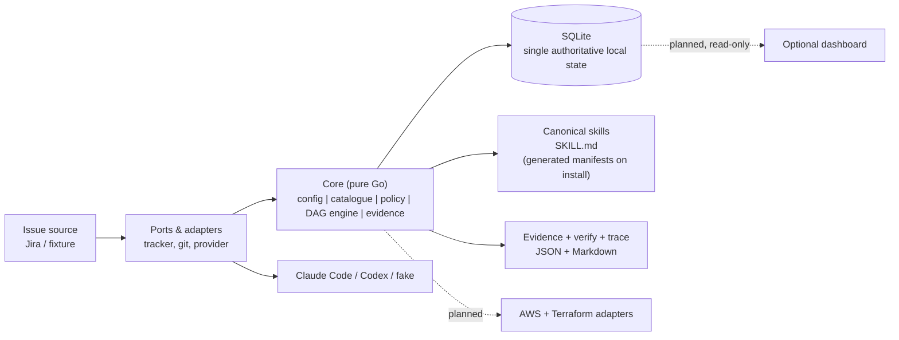

# Architecture

## Goals

- Portable catalogue of versioned skills usable from multiple agent providers.
- Local-first CLI for Jira-to-production engineering with authoritative local state.
- Provider-neutral core; no mandatory cloud service, dashboard, or model.
- Fail-closed policy and immutable evidence for every state transition.

## System shape

A modular monolith with ports/adapters. Core packages (config, catalogue, policy, workflow engine, evidence, state) have no provider SDK imports. Adapters implement narrow interfaces for issue trackers, git hosts, agent providers, and (planned) cloud services.

## Components

### CLI (`aef`, Go 1.27)

Entry point for `init`, `doctor`, `validate`, `skills`, `plan`, `run`,
`status`, `resume`, `cancel`, `approve`, `review --diff`, `review resolve`,
`chat`, `verify`, `worktree`, `trace`, `evidence export`, `eval`, and `version`.
Commands are thin: they parse input, call core services, and render results.
Offline commands require no network access; live Jira/provider commands are
opt-in implementations that were not exercised against live services.

### Configuration and policy

The declared precedence is org > repo > workflow > agent > untrusted content.
This tree loads repository `aef.yaml` and repository policy files; org and
workflow policy layering remains planned. Precedence, highest first:

1. immutable runtime safety rules (compiled in)
2. organization policy
3. repository policy
4. workflow defaults
5. agent instructions
6. untrusted task content (issue text, repo content, tool output, MCP responses)

Conflicts, unknown fields, and missing required policy fail closed. Risk is
derived from changed paths and semantics; unknown semantic tags force
`RiskUnknown`. Policies can be scoped to risk levels, so high-risk gates do not
leak into low-risk runs. Approval rules support multiple approvers, distinct
roles, and rejection of stale or self approvals.

### Canonical asset layout

Skills, workflows, policies, agents, profiles, schemas, and templates live under
`framework/`. Go code resolves them through `internal/framework/paths.go`, so
loaders and docs cannot drift to different locations. Generated provider copies
remain outside this tree in the documented Claude and Codex skill directories.

### Skill catalogue

Canonical skill at `framework/skills/<slug>/SKILL.md`. Each release has a pinned version;
installing skills generates provider manifests listing included files with
SHA-256 checksums. Materialized provider copies are generated, not hand-edited.
Skills are instruction contracts: inputs, outputs, preconditions, failure
behavior — not agent roles.

Phase 1 ships 12 skills. Full domain catalogue is planned for Phase 5.

### Local state

Pure-Go SQLite (`modernc.org/sqlite v1.38.2`) holds runs, transitions,
approvals, evidence references, and an outbox. It is the single authoritative
local state. Updates use optimistic concurrency; approvals survive restart and
legacy rows are migrated on open. Schema validity is checked with JSON Schema
(`santhosh-tekuri/jsonschema v6`); config uses `gopkg.in/yaml.v3 v3.0.1`.

### Workflow engine

Workflows are YAML DAGs of typed tasks with dependencies and conditions. States: `queued`, `analyzing`, `planning`, `awaiting_approval`, `implementing`, `verifying`, `reviewing`, `remediating`, `awaiting_merge`, `staging`, `awaiting_release`, `production_verification`, `completed`, `blocked`, `failed`, `cancelled`. Cycles are rejected; only bounded remediation loops are allowed. A transition and its evidence reference are appended in one SQLite transaction.

Named workflows (definitions present; executable locally with the fake provider): `feature-development`, `bug-fix`, `security-fix`, `infrastructure-change`, `database-migration`, `pull-request-review`, `production-release`, `incident-investigation`, `dependency-upgrade`, `legacy-refactoring`.

### Providers and fakes

A provider port accepts a skill payload and returns a typed result. The
`skills install` command materializes skills into documented Claude/Codex
paths with manifests. Claude Code and Codex CLI adapters exist but were not
invoked in this tree. The fake provider returns outputs marked
`simulated: true` for offline demos; it does not run shell commands or call a
model. Provider name is recorded in task evidence; `model` is recorded when an
adapter reports it and omitted otherwise. Usage is stored as
`known: false` rather than an invented zero. `aef verify` is the local path
that records real command exit statuses.

### Evidence

Content-addressed immutable records with JSON and Markdown exports, local
verification evidence, and a traceability report that marks uncovered stages as
`missing`. See [`evidence.md`](evidence.md).

## What is not implemented

- Live service calls (Jira/Claude/Codex/GitHub), live provider code changes, and CI/deploy hooks. Opt-in Jira, GitHub CLI read/comment, provider-chat, constrained provider-write, and `autopilot` adapters/commands are implemented locally but were not exercised live.
- AWS adapters and Terraform reference architecture.
- Dashboard, multi-user authorization, hosted service.
- Behavioral evaluation suites and the full skill catalogue; structural fixture checks are implemented.
- Signed evidence bundles and cloud artifact storage.

See [`roadmap.md`](roadmap.md), [`progress.md`](../progress.md), and ADRs in [`adr/`](adr/).
