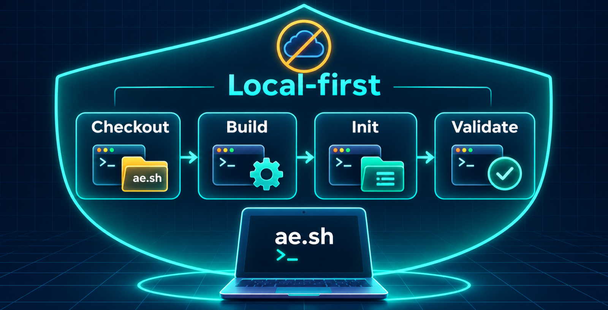

# Installation

AE is distributed as a single Go CLI (`ae`). There is no daemon, database server, dashboard, or cloud account requirement. The install instructions below are for **macOS and Linux**; **Windows is not tested**.

The current pre-1.0 CLI is checkout-scoped: its canonical `framework/` assets
must be available under the AE checkout used as `--root`. It does not yet
install a standalone binary plus a globally discoverable asset bundle for
arbitrary project directories.



The supported setup keeps the framework catalogue and executable CLI together
in one local checkout; no hosted service is required for the offline path.

## Prerequisites

- Go 1.27 (to build from source).
- `make`, `python3`, and `tar` for `make check` and the offline E2E scripts.
- A POSIX shell and git.
- Optional: `gh` authenticated with `gh auth status` for PR reads/comments.
- Optional: Claude Code or Codex installed if you want materialized skills or
  live provider commands. The offline demo needs neither.
- Optional: Jira Cloud API token in your secret manager for live issue intake
  or bug reporting. The offline demo needs no credentials.

## Install from source (macOS / Linux)

```sh
git clone git@github.com:yoosuf/ae.sh.git ae.sh
cd ae.sh
go build -o ae ./cmd/ae
./ae init --profile go
./ae doctor
./ae validate
./ae skills list
```

Run project configuration commands from this checkout, or pass its path
explicitly with `--root /path/to/ae.sh`. `ae init` fails closed when the
canonical assets are not present instead of creating an unusable configuration.

To place it on your `PATH`, use the provided installer (no `sudo` escalation; it asks for confirmation before writing to `/usr/local/bin`):

```sh
scripts/install.sh --prefix "$HOME/.local/bin" --yes   # review target first
```

`scripts/install.sh --help` lists options and writes an install manifest for `scripts/uninstall.sh`. No provider skills are installed by this script.

## Install with `go install` (planned / not available)

The module path is not published as a released module yet. This command will
**not work today** and is shown only as a future shape:

```sh
go install github.com/yoosuf/ae.sh/cmd/ae@latest
```

Use [install from source](#install-from-source-macos--linux) until publication
is announced. Confirm the module path from `go.mod` before relying on this
command.

## Verify an installation

```sh
./ae init --profile go     # once per root; skip if ae.yaml already exists
./ae doctor
./ae validate
./ae skills list
```

These commands are local-only. They should report the local Go/toolchain state and the canonical catalogue; they should not print credentials or contact a provider. If a check fails, fix the reported problem rather than bypassing it. From a source checkout, `make check` also runs build, vet, tests, race tests, validation, the offline end-to-end script, and the worktree end-to-end script in a throwaway git repository.

## Upgrade

For a source checkout:

```sh
cd ae.sh
git pull --ff-only
go build -o ae ./cmd/ae
./ae version
./ae doctor
```

Review the [CHANGELOG](../CHANGELOG.md) and ADRs for breaking changes first; pre-1.0 releases may change behavior. Reinstall provider skills after upgrading so manifests and checksums match the new catalogue version:

```sh
ae skills install --provider all --scope user --dry-run
```

## Uninstall (macOS / Linux)

1. Remove generated provider skill copies you no longer want. Check the exact paths in [provider compatibility](provider-compatibility.md) before deleting anything; only remove directories/files written by AE.
2. Remove the binary with the manifest written by `scripts/install.sh`:

```sh
scripts/uninstall.sh --manifest /path/to/ae-install.manifest \
  --prefix "$HOME/.local/bin" --yes
```

If you installed manually, remove only the binary path you recorded; see
`scripts/uninstall.sh --help` for its safety rules.

3. Remove local AE configuration/state directories you created under your home or project directory, if you no longer need runs and evidence. Back up evidence first if needed.
4. Remove any `PATH` entries you added.

Uninstall does not delete Jira/GitHub data or cloud resources. No cloud resources are created by the implemented local/offline path.

## Offline use

After installation, initialize once, then `ae plan --issue PROJ-101` and `ae run feature-development --issue PROJ-101 --dry-run` use bundled fixtures and the fake provider:

```sh
./ae init --profile go
./ae plan --issue PROJ-101
./ae run feature-development --issue PROJ-101 --provider fake --dry-run
```

A real local run with `--provider fake` creates SQLite state and stops at approval gates; it still needs no credentials or network access. See [getting started](getting-started.md) and the [integration setup guide](integration-setup.md).

## Troubleshooting

| Symptom | Cause | Fix |
| --- | --- | --- |
| `ae.yaml not found (run 'ae init' first)` | No local config. | Run `./ae init --profile go` from the AE checkout. |
| `run init from the AE checkout or pass --root` | Canonical `framework/` assets are missing under the current root. | Run from the checkout or pass `--root /path/to/ae.sh`. |
| `doctor` shows `repository: fail` | `doctor` ran before init, or `--root` is wrong. | Initialize first, then rerun `./ae doctor`. |
| `gh ... failed` | `gh` is missing or not authenticated. | Run `gh auth status` and authenticate outside AE. |
| `not implemented` from Gemini/GitHub App/federated identity/attestation | Fail-closed extension point. | Use the offline path; see [integration setup](integration-setup.md). |
| `npm install --offline` fails with `ENOTCACHED` | Optional UI dependencies are not cached. | Use `npm test --offline`, which needs no install; skip typecheck/build until a normal install is authorized. |

For full setup steps and status labels, see the [integration setup guide](integration-setup.md).

## Known limitations

- No signed binaries or checksum-based release verification yet.
- No Windows support or testing.
- No automatic updater.
- Installation from source is the only supported method in Phase 0–2 until the module path and releases are published.
