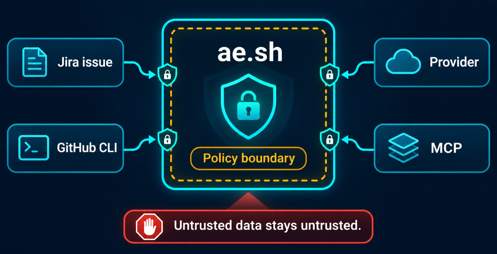

# Integrations



External responses remain untrusted data; explicit configuration, confirmation,
sanitization, and policy gates control what can advance a run.

All integrations sit behind ports in the optional adapter layer. Core packages never import provider SDKs. The implemented path is local filesystem, config, SQLite state, offline fixtures, fake provider, generated skill copies, local approval/evidence lifecycle commands, opt-in Jira Cloud REST intake and bug reporting, opt-in GitHub CLI PR reads/comments, opt-in provider conversations with constrained write modes, and an opt-in `autopilot` orchestration loop. Live Jira writes and other live services were not called in this session; only local HTTP/TLS and CLI-stub tests were run.

## Jira Cloud

Configured opt-in adapter (implemented locally, not exercised live):

```yaml
integrations:
  jira:
    mode: jira-cloud
    baseURL: https://your-site.atlassian.net
    tokenEnv: AE_JIRA_TOKEN
```

- A live `ae run ... --issue TEAM-123 --confirm-live` or `ae autopilot --issue TEAM-123 --confirm-live` accepts a bare issue key or a supported Jira Cloud browse URL when `mode: jira-cloud` is configured. `plan` and `--dry-run` remain fixture-only and never fetch a live issue.
- `baseURL` must be an HTTPS origin with no path, query, fragment, or embedded credentials. A supplied link must use the same host; HTTP links, other hosts, userinfo, and token-bearing query strings are rejected.
- The token is read only from the environment variable named by `tokenEnv`; it is sent as an `Authorization: Bearer` header and never placed in flags, config, prompts, fixtures, URLs, or evidence.
- The adapter requests `summary`, `description`, and `labels` from `/rest/api/3/issue/<key>` and normalizes the response into the provider-neutral `integration.Issue` contract. Response text is sanitized and validated against `framework/schemas/issue.schema.json`.
- AE metadata is mandatory: `ae-acceptance:`, `ae-path:`, optional `ae-semantics:`, `ae-dependency:`, and `ae-base-sha:` labels, or the equivalent description sections. Missing acceptance/path metadata fails closed; no criteria are invented.
- Fixtures remain the offline default. A Jira link without `mode: jira-cloud`, or a live key without `--confirm-live`, is denied with exit code 4.
- `ae jira report-bug` writes one bounded, sanitized bug report through Jira
  Cloud REST v3. Use `--issue TEAM-123` to add a comment to an existing ticket,
  or `--project TEAM [--issue-type Bug]` to create a new ticket. `--title` and
  one of `--description` / `--description-file` are required. A live write needs
  both `mode: jira-cloud` and `--confirm-mutate`; `--dry-run` previews the target
  without building an adapter, reading the token, or writing evidence.
- Bug text is trimmed, bounded (200 title runes, 32 KiB description), scanned
  for credential shapes, sanitized, and sent as an ADF document. Keys, project
  keys, and issue types are pattern-validated; response keys must match the
  requested project. The token is never in flags, config, URLs, prompts,
  fixtures, or evidence.
- With `--run <id>`, the result is recorded as one chained `kind: artifact`
  evidence entry containing digests and identifiers, not raw bug text. A Jira
  response is untrusted data; a successful write satisfies no AE gate.
- No live Jira write was executed. The adapter and CLI are covered by local
  HTTP/CLI-stub tests only. An approved Jira MCP server remains a design target,
  not an implemented adapter.

## GitHub

Two distinct modes must be kept separate:

1. **Local CLI mode (implemented locally, not exercised live):** uses the user's authenticated `gh` CLI on the developer machine. Identity is the local user.
2. **GitHub App / service identity config shape (implemented locally, fails closed):** `integrations.github.mode: github-app` is validated against an HTTPS origin, environment variable *names* for app ID and installation token, and a short service actor. `github.New` refuses this mode, so no identity, token, or service call exists. A least-privilege GitHub App actor for approvals and PR operations is **planned / not implemented** and requires authorization.

Config validation accepts `integrations.github.mode: local-cli` (default),
`disabled`, or `github-app`. `baseURL`, when set, must be an HTTPS origin with no
path, query, fragment, or credentials. `tokenEnv`, `webhookSecretEnv`,
`appIDEnv`, and `installationTokenEnv` must be environment variable *names*.
`actor` is a short local service identity label, not a credential. Credentials
are never placed in config, flags, prompts, fixtures, URLs, or evidence. `ae
doctor` flags `github-app` mode as not implemented.

The local CLI adapter uses argument arrays and supports only:

- `gh pr view` for PR metadata, reviews, and comments.
- `gh pr checks` for check conclusions.
- `gh pr diff` for a bounded diff that can be scanned locally.
- `gh pr comment` for a sanitized comment, and **only** with separate
  `--comment --confirm-mutate` authorization.

`ae autopilot --github-pr <ref> --confirm-live` records those reads as chained
`kind: github` evidence and blocks on failing checks. It never creates a branch
or PR, pushes, merges, or deploys. `ae review --pr 123` without `--diff`
remains **planned / not implemented**; use `--github-pr` on `autopilot` for PR
state evidence only.

`ae review --diff <path> [--run id]` is a deterministic local pattern scan that
reports hypotheses with `verified: false`; it is not an independent review. With
`--run`, the result is written as chained `kind: review` evidence. `ae review
resolve --run id --finding rev-... --status fixed|accepted|false-positive --reason
text` records a human decision as chained `kind: remediation` evidence.
Unresolved findings block merge, release, and security-signoff gates; resolution
does not turn a hypothesis into an independently verified finding. Approvals
bound to a review-evidence digest are invalidated when later review or
resolution evidence changes the digest (`review-findings-change`). High-risk
policies require the `independent-review` gate. A local pattern scan or a
simulated fake-provider review cannot satisfy it. The opt-in command
`ae review --diff <path> --provider claude|codex --skill code-review|security-review|architecture-review|test-review --candidate-sha <sha> --base-sha <sha> --run <id> --workspace <managed-worktree> --confirm-live`
runs the canonical skill through the fixed `independent-review` route, records
`provider`, `routingProfile`, `requestedModel`, `model`, and `reviewMode`, and
writes chained `kind: review` evidence that can satisfy the gate. Provider
findings remain hypotheses until a human resolves them; no live provider review
was invoked in this tree. `--provider fake` is an offline no-op that returns no
findings and cannot satisfy the `independent-review` gate.

## Claude Code

- Skills are Markdown instruction contracts at canonical `framework/skills/<slug>/SKILL.md`.
- Materialized user scope: `~/.claude/skills/<slug>/SKILL.md`.
- Materialized project scope: `.claude/skills/<slug>/SKILL.md`.
- Plugin scope: `<plugin>/skills/<slug>/SKILL.md` with `.claude-plugin/plugin.json`; `ae skills export` generates bundle directories locally.
- Paths above were verified on 2026-11-25. Recheck before use; see [provider compatibility](provider-compatibility.md).
- The Claude Code CLI adapter can run noninteractive prompts from argument arrays. `ae chat --provider claude --confirm-live --workspace <managed-worktree>` opts in to a live conversation; `--resume <session-id>` is used on later turns when the CLI returns `session_id`. `run`, `resume`, and `autopilot` additionally accept `--allow-writes`, which switches tools from `Read` to `Read,Write,Edit` without a shell tool and passes temporary permission settings that block file-tool reads and writes outside the managed worktree. Claude Code v2.1.314 or later is required for those settings; older binaries are rejected. No live model run, resume, or file edit was performed; local stub tests verify both argument shapes.

## Codex

- User scope: `$HOME/.agents/skills/<slug>/SKILL.md`.
- Repo scope: `$CWD/.agents/skills` or `$REPO_ROOT/.agents/skills`.
- Admin scope: `/etc/codex/skills`.
- Optional metadata: `agents/openai.yaml`.
- **`.codex/skills` is not a documented Codex skill path** — do not use or claim it.
- Both Claude Code and Codex follow the agentskills.io open standard.
- The Codex CLI adapter can run noninteractive prompts from argument arrays. Persistent `ae chat --provider codex --confirm-live --workspace <managed-worktree>` uses `codex exec` without `--ephemeral`; later turns use `codex exec resume <thread-id>`. `run`, `resume`, and `autopilot` additionally accept `--allow-writes`, which changes the sandbox from `read-only` to `workspace-write`. No live model run, resume, or file edit was performed; local stub tests verify both argument shapes and thread ID capture.

## Gemini extension point

`provider.default: gemini` is accepted so the provider-neutral boundary is
visible, but `internal/adapters/gemini` declares no live capabilities and
returns `not implemented` from both `Run` and `Cancel`. `ae doctor` reports the
mode as an extension point, and config `SelfCheck` flags it. No binary, API,
credential, session, or model mapping is exercised. A live Gemini adapter and
verified CLI contract remain **planned / not implemented**.

## Federated approver identity (config extension point)

```yaml
integrations:
  identity:
    mode: federated
    issuer: https://id.example.com/realms/ae
    tokenEnv: AE_IDENTITY_TOKEN
    audience: ae-cli
    actorClaim: preferred_username
```

Config validation accepts `local-manual` (default) or `federated`. Federated
mode requires an HTTPS issuer with no userinfo, query, or fragment; a path such
as an OIDC realm is allowed. `tokenEnv` must be an environment variable *name*;
`audience` and `actorClaim` are short labels. No token value is read or stored.
`ae doctor` reports `identity/federated` as an extension point and config
`SelfCheck` flags it. `internal/adapters/identity.New` refuses federated mode and
`Verify` always fails closed. Approvals remain `local-manual` and cannot satisfy
critical-change or organization-identity gates. A live verifier and issuer
contract are **planned / not implemented**.

## External review attestation (config extension point)

```yaml
integrations:
  review:
    mode: external-attestation
    issuer: https://attest.example.com
    verifierEnv: AE_REVIEW_VERIFIER
```

Config validation accepts `local` (default) or `external-attestation`.
External mode requires an HTTPS issuer with no userinfo, query, or fragment and
a verifier environment variable *name*, never a credential or executable path in
config. `ae doctor` reports `review/external-attestation` as an extension point
and config `SelfCheck` flags it. `internal/adapters/attestation.New` refuses the
mode and `Verify` always fails closed. No attestation is accepted as evidence and
no review gate is satisfied by this boundary. An independent verifier and signed
attestation format are **planned / not implemented**.

## Provider model routing

Provider tasks resolve a routing profile from the workflow task, skill metadata
(`ae.model-class`), or agent definition, then map it to a provider model through
`provider.routes` in `ae.yaml`. Precedence is runtime safety/policy, workflow
task, skill, agent, local config, then `balanced`. Untrusted task content cannot
select or downgrade a route. Claude and Codex receive the resolved model via
`--model`; missing mappings fail closed for live providers. The fake provider is
offline and needs no mapping. See [model routing](model-routing.md).

## Provider conversations

`ae chat` is a bounded, opt-in conversation path over the existing provider
port:

- `--provider` is required. `fake` works offline and simulates responses;
  `claude` and `codex` are live providers.
- Optional `--route <profile>` selects a provider-neutral routing profile;
  `provider.routes` in `ae.yaml` resolves it to a model alias/ID. Unknown
  profiles and missing mappings fail closed. See [model routing](model-routing.md).
- Exactly one of `--message` or `--script` is accepted. Scripts are JSON files
  with a `messages` array and at most 20 turns; each turn has a 10s–30m timeout.
- Live providers require `--confirm-live` and `--workspace` pointing to an
  AE-managed detached worktree. Credentials come from the provider's own
  environment; AE never accepts them as flags.
- Session IDs are preserved across turns. If a provider advertises session
  metadata but returns no session ID, the command fails closed.
- With `--run`, each turn writes sanitized `kind: provider` evidence with the
  prompt, response, session ID, routing profile, requested model, actual model
  when reported, simulation flag, usage, and a chained `previousDigest`.
- Provider output remains untrusted text. It is not a check pass, an approval,
  or an independently verified review.
- `chat` is read-only. File edits require `run`, `resume`, or `autopilot` with
  `--allow-writes`, a live provider, `--confirm-live`, and a validated AE-managed
  worktree. Writes are still untrusted until real local checks and gates pass.

## Autopilot (opt-in orchestration)

`ae autopilot` is an explicit opt-in loop that binds a managed detached
worktree to a run, advances workflow tasks, runs real local verification in that
worktree, scans the workspace diff, and stops at every approval or policy gate:

- `--dry-run` is the safe preview mode for planning; it writes no state and
  makes no service call. A non-dry run requires `--issue` or `--resume`.
- Live Jira, provider, and GitHub **reads** require `--confirm-live`.
- Provider file edits require a live provider plus `--allow-writes` and a managed
  worktree.
- Delegated local approvals require both `--approver <name>` and
  `--confirm-gates`. The approver must differ from the run actor. These approvals
  are recorded as `local-manual` and cannot satisfy critical-change identity,
  distinct-role, or independently verified review requirements.
- GitHub PR comments require `--github-pr`, `--comment`, and `--confirm-mutate`.
  That is the only mutating GitHub action in AE.
- The command never pushes, creates a PR, merges, deploys, or invents a check or
  review result. High-risk work still blocks at `independent-review` until a
  non-simulated provider review is recorded; unresolved findings, including
  pattern-scan findings, must be resolved with `ae review resolve`.

## Git worktrees

Implemented local isolation model: `ae worktree prepare <run-id>` creates a
detached worktree under `.ae/worktrees/<run-id>` from the recorded `HEAD`, and
`ae worktree clean <run-id>` removes it without `--force`. Paths outside the
managed root, symlink escapes, unsafe run IDs, branches, commits, pushes, and
deployments are rejected. `ae run --workspace <path>` accepts only those
managed worktrees and records the resolved path in run state and evidence. This
is exercised by `scripts/e2e-worktree.sh` in a throwaway git repository. SQLite
`BindWorkspace` attaches a workspace once and refuses to re-point a run already
bound to a different directory. `git-worktree-management` is also one of the 15
Phase 1 instruction contracts. Live provider code changes inside the worktree
are implemented only behind explicit opt-in flags and were **not exercised
live**; live CI/deploy hooks do not exist.

## MCP servers

MCP may be used for tool access (for example an approved Jira MCP server), but:

- MCP is optional; the framework must work without it.
- MCP output is untrusted data, never policy or control input.
- Tool descriptions and responses can contain prompt injection; sanitize and constrain them.
- Only allow explicitly configured servers; no automatic discovery of arbitrary servers.
- Credentials for MCP servers follow the same no-flags/no-prompts rule.

## Cloud (AWS) adapters — planned / not implemented

AWS usage is optional and adapter-only: API Gateway webhook ingress, SQS queueing, Step Functions Standard orchestration, ECS Fargate execution, DynamoDB state projection, S3 evidence artifacts, Secrets Manager for credentials, CloudWatch/OTel telemetry, and Terraform reference architecture. No cloud resources are created by Phase 0–2, and no account or deployment is assumed.

## Dashboard — implemented locally; hosted/multi-user planned

`ae dashboard snapshot --run <run-id> --out DIR` writes a sanitized, self-contained
static viewer (`index.html`, `app.js`, `styles.css`, `snapshot.json`) from local
run, history, approval, evidence, trace, and review state. Open it directly from
disk; there is no server, API, credential use, or write path. An optional
React/Vite/TypeScript source viewer lives under `ui/`, but no AE command depends
on npm or that build. Hosted and multi-user dashboard features remain planned /
not implemented.
