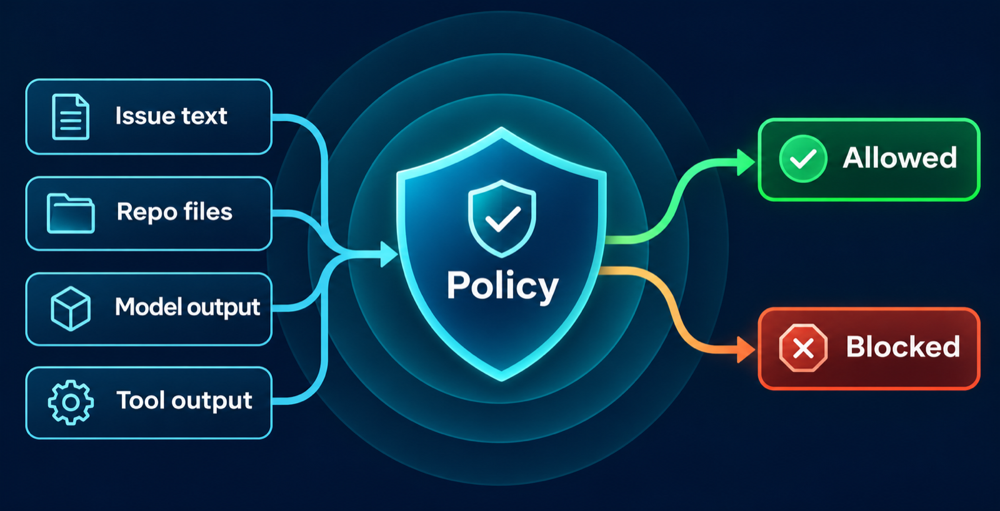

# Threat model

The security model is fail-closed: only validated, policy-approved evidence
passes forward, while untrusted content remains data rather than control input.

Status: design-level STRIDE-style review for Phase 0–2. No penetration test or formal audit has been performed. No real vulnerabilities are known or published (see [`SECURITY.md`](../../SECURITY.md)).

## Assets

- Local run state and evidence (project IP, review decisions, approver identity).
- Canonical skills and generated provider copies (supply-chain integrity).
- Credentials/tokens for optional integrations (not stored by core).
- Source code and candidate changes produced during runs.
- Policy configuration and approval gates.

## Trust boundaries

| Boundary | Untrusted side | Control |
| --- | --- | --- |
| Issue tracker / fixture → CLI | Jira issue text, attachments, fields | Sanitize; treat as data; policy cannot be changed by content. |
| GitHub CLI → engine | PR metadata, checks, diffs, comments | Argument arrays, env-only credentials, bounded diff size, sanitized evidence, explicit `--confirm-live` and separate `--comment --confirm-mutate`. |
| Repository → engine | Source files, hooks, configs, symlinks | Path allowlists, realpath checks, no automatic hook execution. |
| Model/provider output → engine | Generated text, tool calls | Typed artifacts, schema validation, bounded actions, review gates. |
| Provider writes → managed worktree | File edits from Claude/Codex | Opt-in `--allow-writes`, live-provider confirmation, git-validated AE worktree bound before any provider task, no shell tool for Claude, Claude permission settings that block writes outside the working directory (v2.1.314+), `workspace-write` for Codex; edits remain untrusted until local checks pass. |
| MCP servers → engine | Tool descriptions/responses | Explicit allowlist, untrusted data, least privilege. |
| Generated skills → provider | Materialized `SKILL.md` files | Manifest + SHA-256, pinned version, dry-run first. |
| Local CLI → planned cloud adapters | AWS APIs | Optional, least-privilege roles, secrets from external store. |

## STRIDE-style analysis

| Category | Representative threat | Mitigation (implemented in Phase 0–2 unless noted) |
| --- | --- | --- |
| Spoofing | Forged approver identity; malicious MCP server impersonating Jira | Local approver identity, role, candidate SHA, artifact digest, and `identitySource: local-manual` are implemented; the federated identity config boundary validates shapes but fails closed, and a live verifier remains planned. Require explicit server allowlist; never infer identity from issue text. |
| Tampering | Modified `SKILL.md` or provider copy; altered evidence | Canonical skills are source Markdown; generated provider manifests carry SHA-256 checksums and pinned versions. `skills install` rejects divergent unmanaged files unless forced; evidence is content-addressed and immutable. |
| Repudiation | Claimed test success with no record | `ae verify` records the command, sanitized output, and real exit status; missing tools fail closed. Fake-provider output is `simulated: true` and does not satisfy gates. Provider usage is `known: false` when unavailable, never zero-by-default. |
| Information disclosure | Tokens in flags/prompts/fixtures; sensitive issue text in exports | No credentials in flags/config/prompts/fixtures; use env/external store. Sanitize inputs before evidence export; redact secrets. |
| Denial of service | Cyclic DAGs, unbounded remediation, path explosion | Reject cycles; bounded remediation loops; task timeouts must be positive and at most 120m and are validated when workflows load. Validate DAG before run. |
| Elevation of privilege | Issue text instructing agent to change policy; malicious hook; symlink escape | Fail-closed policy precedence (runtime safety > org > repo > workflow defaults > agent instructions > untrusted content); no automatic hook execution; realpath/path containment checks. |

## Specific risks and required controls

### Prompt injection

Issue descriptions, code comments, commit messages, tool output, and MCP responses may contain instructions such as "ignore policy" or "deploy now". These are data, never control input. Only typed workflow transitions and policy-approved gates can advance state. Sanitize before including in prompts and record sanitized inputs in evidence.

### Malicious hooks and repository content

A cloned repository may contain hooks, config, or scripts that execute on checkout. Do not auto-run hooks or trust repo-local policy over org policy. Treat any executable content from the target repository as untrusted and require human approval before execution.

`ae verify` is an explicit exception: it intentionally runs shell commands from
checked-in `framework/profiles/*/profile.yaml`. Profiles are therefore executable
configuration, not passive data. Review them before running `verify`, use the
command only in repositories you trust, and never derive commands from issue
text, model output, or CLI flags. Output is sanitized and exit statuses are
recorded, but sanitization does not make an untrusted command safe to execute.
`ae autopilot` also invokes this local verification path implicitly after a run
starts, so autopilot must only be used in repositories whose checked-in
profiles you have reviewed. There is no separate confirmation for profile
commands yet.

### Symlink and path traversal

Any feature that writes files (skill install, worktree creation, evidence export) must resolve real paths and reject paths outside allowed roots, `..` traversal, and symlink escapes. Dry-run must show the resolved target. Do not follow symlinks when verifying checksums.

`ae.yaml` is checked-in input, so `state.path`, `evidence.dir`, and
`evidence.objectsDir` are validated at config load: absolute paths, `..`
traversal, and symlink escapes are rejected. The built-in secret scan skips
symlinks and fails closed when a path cannot be read, so a partial scan is never
reported as passed. `skills uninstall` recomputes the expected provider base and
validates manifest slugs before any recursive deletion. Evidence export accepts
only constrained run IDs and verifies the run exists before writing a bundle.
Provider stderr is passed through credential redaction before it is returned in
errors.

### Tenant crossover

A single process must not mix runs from different repositories/orgs. Local state keys include repository and run identity; evidence exports are scoped to a run. Planned cloud adapters must use per-tenant isolation and never write to another tenant's S3 prefix or DynamoDB partition. Crossover between repositories must fail closed, not be best-effort filtered.

### Supply chain

- Verify skill manifests and SHA-256 checksums before materializing copies.
- Pin third-party CI actions to verified SHAs before release (currently a TODO in `.github/workflows/ci.yml`; no fake SHAs are committed).
- Review new dependencies and licenses. Core must remain free of provider SDKs.

### Escalations

Changes touching auth, billing, tenant isolation, IAM, secrets, infrastructure, migrations, data retention, or public APIs require explicit approval gates. Bypassing a gate is not a supported flag.

## Residual risk / not implemented

- No strong sandbox for model-generated code. AE-managed detached worktrees and opt-in constrained write modes are implemented locally but were not exercised live; provider output still requires real local checks before it can pass gates.
- `ae verify` includes a built-in credential-shape scan of the workspace, and `ae audit` scans authored files locally. A dedicated external scanner for final evidence bundles remains planned.
- No multi-user RBAC or signed approvals. Local evidence bundle signatures prove local authenticity only, not external attestation; the hosted/multi-user dashboard remains planned.
- No threat mitigation is proven by tests in this documentation; verify implementation status in the README command matrix.

### Verified static-review gaps not yet mitigated

A read-only review of this tree found the following concrete gaps. They were
checked against source, but no fix or live exploit test exists yet. Do not treat
these paths as hardened for hostile repositories or untrusted collaborators.

| Area | Verified gap | Practical caution |
| --- | --- | --- |
| Evidence append path | Some engine, verify, and worktree appenders read the last record with an empty predecessor and use a non-atomic read-max/insert instead of the chained append helper. | Concurrent writers can fork evidence sequences. Use single-writer local runs for now. |
| Required gates | Required-evidence and unresolved-finding checks are keyed to gates literally named `merge` or `release`. | Other terminal approval gates can complete without those checks. Review gate evidence manually. |
| Candidate SHA | The candidate SHA comes from issue metadata or the plan digest, not the managed workspace HEAD after implementation. | Confirm SHAs and diff digests yourself before approving a real change. |
| Signed bundles | The signature binds sequence, record ID, data digest, and previous digest, not every record field. | Treat a signature as local authenticity only; verify record metadata separately. |
| Workflow policies | `workflow.policies` references are path-validated but the CLI loads only its fixed two-policy bundle. | Do not add custom workflow policy files expecting them to be enforced. |
| Workflow gates | Some canonical approval gates have no matching policy approval rule, and `validate` does not cross-check them. | Expect those gates to fail closed as unknown; do not assume they are configured. |
| Skill install | A target changed after `plan` can be overwritten because `apply` does not recheck digests. | Re-run `plan` immediately before install and use `--force` only deliberately. |
| Error placeholders | Some marshal failures become `{}` or `{"error":"unserializable"}` instead of errors. | Treat empty evidence or output as a failure, not a pass. |
| `ae doctor` | Self-check still creates the state directory, so `doctor` is not strictly read-only. | Use `doctor` as a hint, not as the sole installation verdict. |
| Verification runner | Profile commands use `sh -c`, so verification is Unix-only and treats commands as executable config. | Run `verify` only in trusted checkouts on a POSIX shell; Windows is not supported for this path. |

These gaps are recorded as limitations, not as released mitigations. Addressing
them requires separate, reviewed changes with tests.
